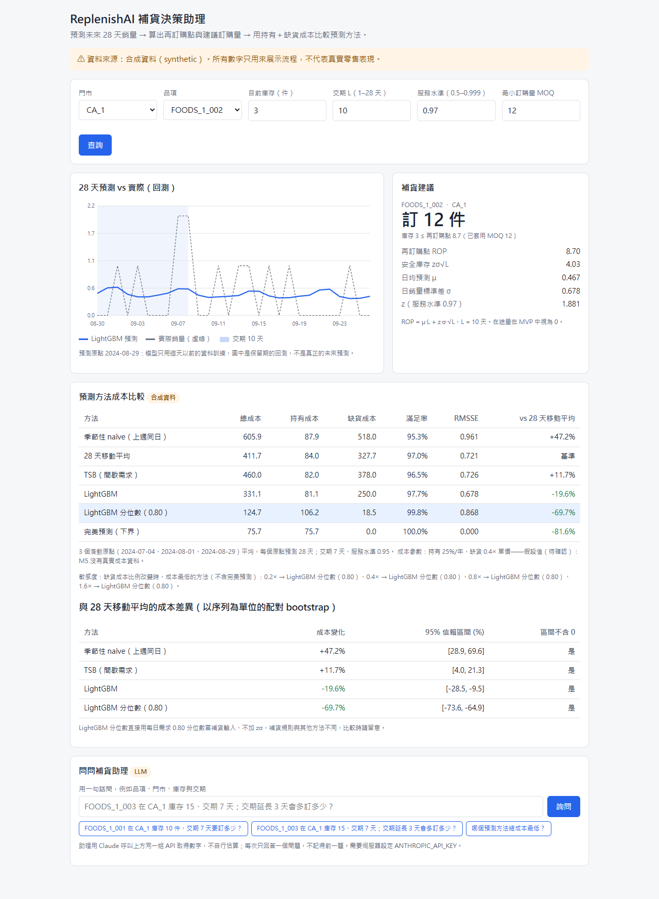

# ReplenishAI — 需求預測與補貨決策助理

預測每個品項未來 28 天的銷量，把預測轉成「現在該補多少貨」，再用**持有成本＋缺貨成本**比較不同預測方法，用金額而不只是誤差來評估模型。

> ⚠ **目前所有數字都來自合成資料（synthetic）**。資料欄位與 M5（Walmart）格式相同，但數字是程式產生的，**不代表真實零售表現**。API 每個回應和頁面都會標示 `data_source`。換成真實 M5 資料的方法見[下方說明](#換成真實-m5-資料)。

## 解決什麼問題

中小型零售店的採購人員每週要決定上百個品項各補多少貨。常見做法是用 Excel 算移動平均，結果旺季缺貨、淡季積壓。而且「預測準不準」和「實際多花多少錢」沒有被放在一起看。

ReplenishAI 提供一頁看板：選擇門市與品項 → 看 28 天預測 → 輸入目前庫存、交期、服務水準、MOQ → 得到再訂購點與建議訂購量；同時列出不同預測方法的成本比較。

## 結果（合成資料，3 個滾動原點平均）

每個原點都只用原點以前的資料重新訓練，再預測接下來 28 天。完整表格見 [docs/results.md](docs/results.md)。

| 方法 | RMSSE ↓ | 總成本 ↓ | vs 28 天移動平均 | 滿足率 |
|---|---:|---:|---:|---:|
| 季節性 naive（上週同日） | 0.961 | 605.9 | +47.2% | 95.3% |
| 28 天移動平均（基準） | 0.721 | 411.7 | — | 97.0% |
| TSB（間歇需求） | 0.726 | 460.0 | +11.7% | 96.5% |
| **LightGBM** | **0.678** | **331.1** | **−19.6%** | **97.7%** |
| LightGBM 分位數（0.80）＊ | 0.868 | 124.7 | −69.7% | 99.8% |
| 完美預測（成本下界） | 0 | 75.7 | −81.6% | 100% |

＊直接用每日需求的 0.80 分位數當補貨輸入、不加 zσ，補貨規則與其他方法不同；預測偏誤 +1.15（系統性高估）。

- **統計檢查**（以序列為單位的配對 bootstrap，95% 信賴區間，相對 28 天移動平均）：LightGBM −19.6% [−28.5, −9.5]；LightGBM 分位數 −69.7% [−73.6, −64.9]；TSB +11.7% [+4.0, +21.3]。四個區間都不含 0。
- 缺貨成本比例從 0.2 調到 1.6 倍單價時，排名不變：LightGBM 分位數最低，其次是點預測 LightGBM（不含完美預測）。
- 分位數策略的大幅領先在服務水準提高到 0.99 後仍在，原因未明，可能和合成資料內建的需求尖峰有關，**必須在真實資料驗證**後才能下結論。
- TSB 比移動平均差：這份資料的零值不多，不算間歇需求。
- 成本參數（持有成本年化 25%、缺貨成本 0.4× 單價）是**假設值**，M5 沒有真實成本資料。
- 所有方法共用相同的起始庫存、σ、服務水準與成本，差別只在預測。

### 對照 project-brief 的成功標準（Q5）

| 標準 | 狀態 |
|---|---|
| 1. 預測誤差優於季節性 naive | 合成資料上達成（0.678 vs 0.961）；真實 M5 未測 |
| 2. 總成本優於移動平均基準 | 合成資料上達成（−19.6%）；真實 M5 未測 |
| 3. API 本機與雲端可操作，p95 < 1 秒 | 本機與 Docker 可操作，本機 p95 ≈ 5 ms；雲端尚未部署 |
| 4. LLM 工具呼叫正確率 ≥ 80% | 助理與 30 題評測集已完成；**尚未用真實模型跑評測**（需 API key），所以還不能宣稱達成 |
| 5. Demo、Repo、測試紀錄 | Repo 與測試紀錄已有；Demo 網址或影片尚未完成 |

## 怎麼做的

```
data/raw/ (M5 格式 CSV)
   │  replenishai/data.py, features.py       讀檔、轉長表；lag/滾動特徵至少位移 28 天（防資料洩漏）
   ▼
scripts/run_experiment.py                    3 個滾動原點 × 6 種方法：預測 → 誤差 → 庫存模擬 → 成本
   │                                         （baselines.py, models.py, policy.py, simulate.py）
   ▼
artifacts/ (results.json, holdout_forecasts.csv, series_stats.csv)
   │
   ▼
replenishai/api.py (FastAPI)  ──  static/index.html（同一個服務提供，免 CORS）
```

- **模型**：LightGBM，Poisson 目標（銷量是非負計數）。另有 LightGBM 分位數版本（0.80）。基準是季節性 naive、28 天移動平均與 TSB（間歇需求），另外用完美預測當成本下界。
- **補貨**：再訂購點 `ROP = μ·L + z·σ·√L`；庫存 ≤ ROP 時訂 `max(MOQ, ⌈ROP − 庫存⌉)`，否則不訂。
- **評估**：用保留期的真實需求逐日模擬庫存，計算持有與缺貨成本，並做缺貨成本比例的敏感度分析。
- **API 不在請求時訓練**：啟動時讀取 `artifacts/`，缺檔就拒絕啟動，並提示要先跑哪個腳本。

## 快速開始

需要 Python 3.12。

```bash
pip install -r requirements.txt
python scripts/run_experiment.py          # 沒有 M5 檔案時會自動產生合成資料；約 20 秒
uvicorn replenishai.api:app --reload      # 開 http://127.0.0.1:8000（看板）或 /docs（API 文件）
```

### Docker

```bash
docker compose up --build                 # 建置時會跑實驗；開 http://localhost:8000
```

容器會讀取環境變數 `PORT`（預設 8000），可以直接部署到 Railway 等平台，見 [docs/deploy-railway.md](docs/deploy-railway.md)。
映像檔只安裝 `requirements-runtime.txt`（固定版本），以非 root 使用者執行，內建 `/health` 健康檢查。
這版 Dockerfile 只在乾淨 venv 中模擬過建置步驟，部署前請先實際 `docker compose up --build` 一次。

### 測試

```bash
pytest -q                                 # 65 項；API 測試會用 artifacts 重算並比對 API 回傳的數字
python scripts/check_dashboard.py http://127.0.0.1:8000 docs/evidence   # 瀏覽器實測頁面（需 pip install playwright 與 Edge）
```



## API

| 方法 | 路徑 | 用途 |
|---|---|---|
| GET | `/health` | 狀態、資料來源、預測原點、序列數 |
| GET | `/series` | 可選的門市與品項（填看板選單） |
| GET | `/forecast?item_id=&store_id=` | 單一品項 28 天 LightGBM 預測與實際值（回測） |
| POST | `/replenish` | 再訂購點、安全庫存、建議訂購量；交期限 1–28 天、服務水準 0.5–0.999，超出範圍回 422，查無品項回 404 |
| GET | `/compare` | 各方法的誤差、成本與敏感度分析 |
| POST | `/chat` | 用自然語言提問，LLM 助理呼叫上面的工具回答；未設定 `ANTHROPIC_API_KEY` 時回 503 |

範例：

```bash
curl -X POST http://127.0.0.1:8000/replenish -H "Content-Type: application/json" \
  -d '{"item_id":"FOODS_1_001","store_id":"CA_1","on_hand":3,"lead_time_days":7,"service_level":0.95,"moq":0}'
```

## LLM 補貨助理

頁面最下方可以直接問，例如「FOODS_1_003 在 CA_1 庫存 15、交期 7 天；交期延長 3 天會多訂多少？」。

- **不讓模型猜數字**：Claude（`claude-opus-5-5`）只能透過 4 個工具取得數字：查門市與品項、查預測、算補貨、比較方法。這些工具和 REST API 共用 `replenishai/service.py`，所以助理說的數字和看板一致。
- **範圍限制**：查無品項、交期超出 1–28 天、沒給庫存時，助理會照實說明或反問，不會換參數硬算；天氣、下單這類請求會拒絕。每次只回答一題，不記得前一題。
- **啟用**：設定環境變數 `ANTHROPIC_API_KEY`（不要寫進 Repo）。沒設定時 `/chat` 回 503，其他功能照常。
- **評測**：`eval/assistant_cases.json` 有 30 題（查詢 10、模擬 14、拒答/澄清 6）。`python scripts/eval_assistant.py` 會實際呼叫模型並評分：
  - 工具呼叫是否正確：工具、參數，以及不該成功的呼叫有沒有被擋下
  - 回答裡的數字能否對應到工具輸出
  
  結果寫入 `docs/assistant-eval.md`。每題 2–4 次模型呼叫，跑完會印出實際 token 數與估算費用。**目前還沒跑過。**
## 換成真實 M5 資料

1. 從 Kaggle 的 [M5 Forecasting - Accuracy](https://www.kaggle.com/competitions/m5-forecasting-accuracy/data) 下載 `calendar.csv`、`sales_train_evaluation.csv`、`sell_prices.csv`（需登入並同意競賽規則；檔案很大，不放進 Repo）。
2. 刪除 `data/raw/` 裡的合成資料（包括 `SYNTHETIC.txt` 標記檔），放入上述三個檔案。
3. 重跑 `python scripts/run_experiment.py`，`data_source` 會變成 `m5`，`docs/results.md` 也會重新產生。

真實 M5 有約 3 萬條序列，訓練時間與記憶體需求會比合成資料大很多，目前還沒在真實資料上跑過。

## 限制

- 結果只來自合成資料，真實零售表現未知。
- 成本參數是假設值；沒有考慮訂購成本、在途量（MVP 視為 0）與供應商限制。
- σ 取訓練期最後 56 天的日銷量標準差，屬簡化設定。
- `/forecast` 回傳的是最後 28 天的回測預測，不是真正的未來預測。
- 尚未雲端部署；LLM 助理的真實模型評測尚未執行（需要 API key）。部署到公開網址時，任何人使用 `/chat` 都會花費 API 額度。

## 文件

| 文件 | 內容 |
|---|---|
| [project-brief.md](project-brief.md) | 發想與成功標準 |
| [docs/02-prd.md](docs/02-prd.md) ・ [03-srs](docs/03-srs.md) ・ [04-sad](docs/04-sad.md) ・ [05-sds](docs/05-sds.md) | 需求、規格、架構、設計（需求編號可追溯到測試） |
| [docs/06-test-plan.md](docs/06-test-plan.md) | 測試案例與實際證據 |
| [docs/results.md](docs/results.md) | 實驗結果（由腳本自動產生） |
| [docs/dev-notes.md](docs/dev-notes.md) | 開發手記 |

進度：`python scripts/git_monitor.py` 會比對 `schedule.json` 與 git 紀錄。
